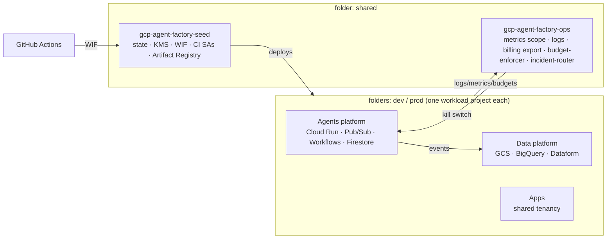

# DESIGN.md: system design source of truth

This file holds the **rules that must stay true**. The roadmap and reasoning are in [`docs/PLAN.md`](docs/PLAN.md); individual decisions are in [`docs/adr/`](docs/adr/README.md). If a change breaks an invariant below, it needs an ADR first.

## 1. System overview

Platforms: **landing zone** (org, folders, projects, policies, network), **agents**, **data**, **ops**. Region `europe-north1`. Stacks apply in order `bootstrap → foundation → network → ops → data → agents → apps`.

## 2. Principles

1. **Serverless and scale-to-zero first.** Idle cost should round to zero.
2. **Stateless compute.** State lives only in Firestore, BigQuery or GCS.
3. **Idempotent everything.** Messages carry idempotency keys; IaC converges; retries are always safe.
4. **Event-driven and durable.** Pub/Sub with DLQs for async work, Cloud Workflows for multi-step and human-in-the-loop work.
5. **Identity per workload.** One service account per agent and app; IAM is the call graph.
6. **Agents propose, pipelines dispose.** Agents never mutate infra with their own credentials; approved GitHub Actions runs do.
7. **Contracts first.** Event schemas, agent manifests and data contracts are versioned and validated in CI.
8. **Everything as code.** OpenTofu for infra, YAML or JSON for dashboards and policies, Markdown for runbooks. No click-ops after bootstrap.
9. **Secure and cost-aware by default.** Guardrails live in org policies, quotas and CI, not in good intentions.

## 3. Invariants

| ID | Invariant | Enforced by | Status |
|---|---|---|---|
| INV-01 | No service-account keys exist anywhere | org policy `iam.disableServiceAccountKeyCreation`; WIF for CI | Phase 1 |
| INV-02 | Every labelable resource carries the standard labels from `modules/labels` | module validation + conftest plan policy + asset scan | module ✅ · policy Phase 1 |
| INV-03 | Infra changes reach GCP only through CI | WIF bindings to GitHub environments; Claude hook + deny rules | hooks ✅ · WIF Phase 1 |
| INV-04 | Every Pub/Sub subscription has a DLQ, retry policy and max delivery attempts | `modules/pubsub-channel` + conftest | Phase 3 |
| INV-05 | Every agent has a manifest, own SA, budget and kill switch | `modules/agent-service` reads the manifest; JSON Schema in CI | Phase 3 |
| INV-06 | Every message handler is idempotent | `agent-core` ledger + BDD duplicate-delivery scenarios | Phase 3 |
| INV-07 | No internet egress unless declared in a manifest | Direct VPC egress + firewall; manifest review | Phase 1/3 |
| INV-08 | Every data product has a validated ODCS contract | `modules/data-product` + `check-jsonschema` | Phase 4 |
| INV-09 | Python code has 100% line + branch coverage; exclusions are justified | `pytest --cov` `fail_under = 100`; `repo-checks pragmas` | ✅ |
| INV-10 | Every requirement is traced to a test | `repo-checks traceability` | ✅ |
| INV-11 | Third-party CI and hook code is pinned to commit SHAs | `repo-checks pins` + zizmor + Renovate | ✅ |
| INV-12 | Skills, subagents and ADRs are well-formed and indexed | `repo-checks skills/subagents/adrs` | ✅ |
| INV-13 | No secrets in the repo | gitleaks (pre-commit + CI) + GitHub push protection | ✅ |

## 4. Cost guardrails

**Avoid list** (fixed or idle costs that would eat a $300 trial): Cloud NAT, load balancers and forwarding rules, Serverless VPC Access connectors, PSC endpoints, Cloud SQL, AlloyDB, Memorystore, GKE node pools, Composer, Dataflow, Dataproc, Vertex AI online prediction or Vector Search endpoints, Agent Engine with min instances, SCC Premium, Cloud Armor, extra Firestore databases (the free tier only covers `(default)`), long log retention, high-cardinality metrics.

Using anything on that list requires an ADR with a cost estimate and a budget.

**Kill-switch layers** (detail in [ADR-0008](docs/adr/0008-kill-switch-layers.md)): L0 agent soft flag → L1 agent SA disable → L2 env-wide soft stop at 90% budget → L3 billing detach at 110% (dev/prod only) → L4 free-trial exhaustion.

## 5. Naming

Everything derives from `gcp-agent-factory` (short alias `gaf` where length limits bite), except the org name and the identity domain `smartass.dad` ([ADR-0017](docs/adr/0017-existing-sandbox-org.md)). Core project IDs are `gcp-agent-factory-<seed|ops|dev|prod>-<sfx>`; app projects are `gaf-app-<name>-<sfx>`. The full table is in [PLAN §4.0](docs/PLAN.md#40-naming).

## 6. Decisions

See the [ADR index](docs/adr/README.md). Superseding a decision means a new ADR, never an edit to the old one's decision section.
