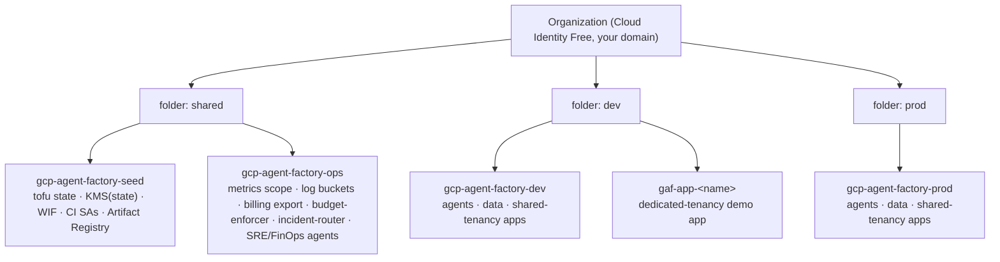
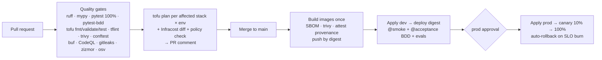
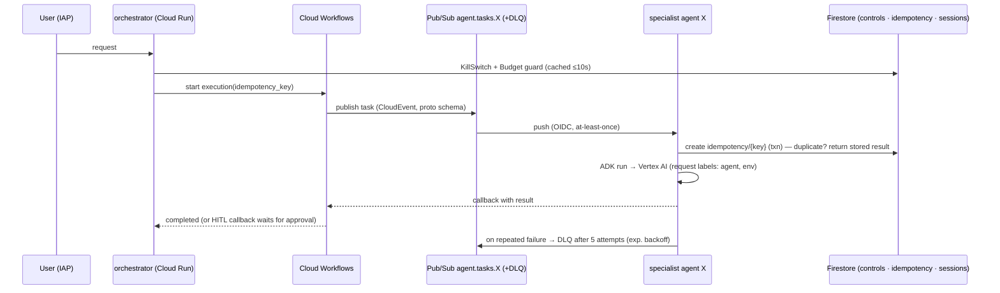
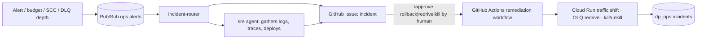

# Agentic Demo Platform on GCP — Monorepo Plan

> Status: **DRAFT v0.2** (2026-10-23) — planning only, nothing provisioned yet.
> Decisions confirmed so far: Cloud Identity Free org · region `europe-north1` · public GitHub repo [`liljestk/gcp-agent-factory`](https://github.com/liljestk/gcp-agent-factory) · dev + prod with 5 projects · platform name **gcp-agent-factory** (naming rules in §4.0).
> Project IDs in this doc leave out their 4-char suffix for readability: `gcp-agent-factory-prod` means `gcp-agent-factory-prod-<sfx>`.

---

## 1. Goals and non-goals

### Goals

1. **Agents platform**: multi-agent orchestration with Google ADK on GCP. Each agent has its own identity, labels, budget and kill switch.
2. **Landing zone**: a secure but simple org/folder/project baseline that additional apps can be "landed" into via a paved road.
3. **Data platform**: a secure but simple place to define, build, govern and publish data products.
4. **Operations platform**: observability, FinOps, incident response and *agentic* operations for 1–3.
5. **Demo value**: show end-to-end agentic app *building* (an agent opens a PR that lands a new app) and *operating* (an agent triages incidents and proposes fixes that pipelines execute).

### Hard constraints

- All infrastructure in **OpenTofu**. No click-ops except the few bootstrap steps GCP can't automate (listed in §12).
- Aligned with the **Google Cloud Well-Architected Framework** (6 pillars plus the AI/ML perspective). The control mapping is in §11.
- **GitHub + GitHub Actions** for fully automated deployment, using keyless auth (Workload Identity Federation).
- **$300 / 90-day free trial**: target ≤ $15/month idle and ≤ $60/month during active build/demo (§9).
- Secure coding, strict linting, **100% coverage** on code, **BDD** acceptance tests, and agent evals.
- Robust, modular, stateless and idempotent, with durable execution and recovery.

### Non-goals (for now)

- Multi-region active-active. It needs a global load balancer and multi-region data, which costs more than the budget allows. DR is "pilot light via IaC" instead (§7.6).
- GPUs, GKE, Cloud SQL, Composer, Dataflow, Vertex AI online endpoints, Vector Search endpoints. All of these have always-on costs (§9.3).

---

## 2. Key architecture decisions (each one becomes an ADR in `docs/adr/`)

| ADR | Decision | Choice | Main reason |
|---|---|---|---|
| 0001 | Repo shape | Monorepo, domain-oriented (`platforms/*`), uv workspace, `just`, `mise`, devcontainer | One place for agents, IaC, specs and tests; works the same on Windows via the devcontainer |
| 0002 | Agent framework | **Python + Google ADK 2.x** (graph workflows, resumability, plugins, A2A) | Python ADK is the most mature; 2.x adds deterministic graph orchestration |
| 0003 | Agent runtime | **Cloud Run** (one service per agent, scale-to-zero) | $0 idle, per-agent service account, IAP direct. Agent Engine stays an optional target (Phase 7) |
| 0004 | Durable execution | **Pub/Sub + Cloud Workflows + Cloud Tasks**, with Firestore for idempotency and ADK session state | Pay-per-use and nearly free at demo scale. Temporal needs always-on workers and a DB, which would burn the budget. A `DurableExecutor` port keeps a Temporal adapter possible (the official ADK Temporal plugin exists) |
| 0005 | State stores | Firestore `(default)` DB, BigQuery, GCS. **No Cloud SQL/Memorystore** | Firestore's free tier only applies to the `(default)` database; SQL is always-on |
| 0006 | Event contracts | CloudEvents envelope + **Protobuf** schemas, `buf lint`/`buf breaking`, Pub/Sub topic schemas (JSON encoding) | The broker enforces schemas, and breaking changes are caught in CI |
| 0007 | Agent identity | **Service account per agent**, generated from an agent manifest (`agent.yaml`) | Least privilege, an IAM-enforced call graph, and per-agent audit and cost |
| 0008 | Kill switches | 5 layers, from an in-process guard up to billing detach (§6.4) | Fast soft stops plus hard backstops |
| 0009 | Topology | Org → 3 folders → 5 projects (§4) | Fits the free-trial project quota while still isolating envs |
| 0010 | Network | Serverless-first, **no Cloud NAT, no load balancers**, Private Google Access + restricted VIP, VPC-SC dry-run → enforce | Removes the two biggest hidden fixed costs; agents default to Google-APIs-only egress |
| 0011 | IaC | OpenTofu with **client-side state encryption (`gcp_kms`)** + CMEK GCS backend | State is encrypted before it leaves the runner, which Terraform can't do |
| 0012 | CI/CD | GitHub Actions + WIF; build once, **promote by digest**; plan on PR, apply on merge; environments `foundation`/`dev`/`prod` with approvals | No long-lived keys and reproducible promotion |
| 0013 | Testing | 100% line+branch coverage, **pytest-bdd** Gherkin, ADK evals, `tofu test` with mock providers, conftest plan policies | Covers code, behaviour, agent quality and IaC |
| 0014 | Data products | **ODCS** (Open Data Contract Standard) YAML contracts + Dataform + BigQuery; dogfood the platform's own data first | Free transformation tool; contracts are testable in CI |
| 0015 | Model endpoint | Gemini on **Vertex AI** (Flash-tier by default, model set per agent in its manifest), EU endpoint where available | Request labels give per-agent cost attribution, which the AI Studio API doesn't |
| 0016 | Dev workflow | Spec-driven: `AGENTS.md` (canonical) + `CLAUDE.md` + `DESIGN.md` + `specs/*/{requirements,design,tasks}.md` + skills | Humans and coding agents share one source of truth |

---

## 3. Monorepo layout

```text
.
├── AGENTS.md                  # canonical instructions for ALL coding agents (tool-agnostic)
├── CLAUDE.md                  # @AGENTS.md + @DESIGN.md imports + Claude-specific notes (skills, hooks, subagents)
├── DESIGN.md                  # system design source of truth: principles, invariants, boundaries, ADR index
├── README.md  SECURITY.md  CONTRIBUTING.md  LICENSE
├── .claude/
│   ├── settings.json          # permissions (deny apply/destroy/key-create), hooks (fmt on edit, destructive-cmd guard)
│   ├── skills/                # SKILL.md packages (portable format) — see §10.3
│   └── agents/                # subagents: tofu-reviewer, security-reviewer, finops-reviewer, test-writer, waf-reviewer
├── .github/
│   ├── workflows/             # ci, deploy, drift, killswitch, finops-report, chaos, teardown, release
│   ├── actions/               # composite: setup-toolchain, gcp-auth, tofu-stack
│   ├── CODEOWNERS  renovate.json  pull_request_template.md  ISSUE_TEMPLATE/
├── .devcontainer/             # canonical dev env (Docker is already installed on this machine)
├── mise.toml                  # pinned tool versions: tofu, tflint, trivy, conftest, buf, uv, python, just, gcloud
├── justfile                   # task runner: `just check`, `just test`, `just plan stack=agents env=dev`, ...
├── pyproject.toml  uv.lock    # uv workspace root (ruff, mypy, pytest, coverage config shared here)
├── .pre-commit-config.yaml    # ruff, mypy, tofu fmt, tflint, gitleaks, buf, check-jsonschema, markdownlint, actionlint
├── .gitattributes             # `* text=auto eol=lf` (Windows-safe)
│
├── docs/
│   ├── adr/                   # MADR-format ADRs 0001..
│   ├── architecture/          # C4 diagrams (mermaid), threat model
│   ├── waf/                   # one checklist per WAF pillar → links to controls in code
│   ├── runbooks/              # incident, kill-switch, DLQ redrive, DR, end-of-trial teardown
│   └── finops/                # budgets, cost model, label taxonomy
├── specs/                     # spec-driven feature work
│   └── <NNN-slug>/{requirements.md, design.md, tasks.md}
│
├── platforms/
│   ├── landing-zone/          # (2) org, folders, org policies, projects, network, IAM, budgets, app templates
│   │   ├── infra/bootstrap/   # run ONCE locally: seed project, state bucket, KMS, WIF, CI SAs, Artifact Registry
│   │   ├── infra/foundation/  # org policies, folders, tags, projects, budgets, quotas
│   │   ├── infra/network/     # per-env VPC, subnets, DNS (restricted VIP), firewall, VPC-SC
│   │   └── templates/app-cloudrun/   # copier template for vended apps
│   ├── agents/                # (1)
│   │   ├── registry/          # <agent>.yaml manifests → drive infra (SA, Cloud Run, IAM, topics, budgets)
│   │   ├── agents/<name>/     # one uv package per agent (src/, tests/, features/, evals/, Dockerfile)
│   │   ├── workflows/         # Cloud Workflows definitions (durable multi-step + HITL)
│   │   └── infra/             # stack: reads registry/*.yaml
│   ├── data/                  # (3)
│   │   ├── products/<name>/   # contract.yaml (ODCS), dataform/, features/
│   │   ├── ingestion/
│   │   └── infra/
│   └── ops/                   # (4)
│       ├── services/          # budget-enforcer, incident-router, killswitch-cli
│       ├── observability/     # dashboards/, alerts/, slos/ (as code)
│       └── infra/
├── apps/                      # apps landed through the landing zone (Phase 6)
│
├── libs/                      # shared Python packages (uv workspace members)
│   ├── agent-core/            # ADK plugins: KillSwitch, Budget, Telemetry, Policy(HITL); idempotency; model factory; Firestore SessionService
│   ├── events/                # protobuf schemas + generated models + CloudEvents helpers
│   └── testing/               # fakes, emulator fixtures, shared BDD steps
├── modules/                   # reusable OpenTofu modules (no provider blocks, each with tests/)
│   ├── labels/  project/  wif-github/  network/  org-policies/  kms/
│   ├── agent-service/  pubsub-channel/  durable-workflow/  budget-guard/
│   ├── data-product/  log-sink/  observability/  app-tenant/
├── policies/                  # conftest/OPA rego run against plan JSON (labels, no public IAM, DLQ required, ...)
├── contracts/                 # JSON Schemas: agent manifest, data contract, app manifest
└── tests/acceptance/          # cross-platform BDD run against a deployed env (@smoke, @acceptance, @security, @chaos)
```

Why `platforms/*` co-locates code and infra: each platform maps to one CODEOWNERS entry, one nested `AGENTS.md`, one CI path filter and one set of state files. Shared building blocks live in `modules/` and `libs/`.

---

## 4. Landing zone (platform 2)

### 4.0 Naming

Everything derives from the repo name **`gcp-agent-factory`**. The short alias **`gaf`** is used only where GCP length limits bite.

| Thing | Pattern | Example / note |
|---|---|---|
| GitHub repo | `liljestk/gcp-agent-factory` | public · `repository_id=1431415117` · `repository_owner_id=4373495` (pinned in the WIF condition, §5.1) |
| Organization | the Cloud Identity **primary domain** *is* the org name | GCP can't name an org separately from its domain. Candidates derived from the repo name (unregistered per RDAP on 2026-10-23): `gcp-agent-factory.dev` / `.com` / `.cloud` (see note below) |
| Core project IDs | `gcp-agent-factory-<role>-<sfx>` | `gcp-agent-factory-prod-k3x9`: 27 chars, under the 30-char limit |
| Project display names | `gcp-agent-factory <role>` | `gcp-agent-factory prod` |
| App project IDs | `gaf-app-<name>-<sfx>` | the full name would leave only 3 chars for `<name>` |
| `<sfx>` | 4 random chars, generated once in `bootstrap` and kept in state | a deleted project ID can **never** be reused, so the suffix lets `teardown` → re-create work |
| State bucket | `gcp-agent-factory-tfstate-<sfx>` | in `gcp-agent-factory-seed` |
| Service accounts | `ci-<role>`, `agt-<agent>`, `app-<name>` | the project already scopes them, so no prefix |
| Labels | `repo=gcp-agent-factory` on every resource | plus the taxonomy in §9.1 |
| Folders | `shared`, `dev`, `prod` | display names under the org |

Note on the domain: a domain that contains "gcp" may run into Google's trademark and brand guidelines. If you'd rather avoid that, use a neutral domain or a subdomain you already control (e.g. `agent-factory.<your-domain>`); nothing else in the naming changes.

### 4.1 Resource hierarchy



- **Org-level tags**: `env` (shared|dev|prod) bound to folders. They're used in IAM conditions and conditional org policies.
- **Groups instead of users** (Cloud Identity Free supports groups): `gcp-org-admins`, `gcp-billing-admins`, `gcp-platform-engineers`, `gcp-security-reviewers`, `gcp-viewers`. Plus one documented **break-glass** account.
- **App tenancy tiers**: (a) *shared*, where an app runs in the dev/prod project with its own SA, labels and budget filter (default, cheap); (b) *dedicated*, where the app gets its own project via the project factory (shown with one app, and grows when quota allows).

### 4.2 Org policies (managed by OpenTofu, rolled out with `dry_run_spec` first)

Security: `iam.disableServiceAccountKeyCreation`, `iam.disableServiceAccountKeyUpload`, `iam.serviceAccountKeyExposureResponse`, `iam.automaticIamGrantsForDefaultServiceAccounts`, `iam.allowedPolicyMemberDomains` (blocks `allUsers`, so every Cloud Run service requires auth; check that WIF `principalSet://` members are compatible, or use the managed `iam.managed.allowedPolicyMembers`), `storage.uniformBucketLevelAccess`, `storage.publicAccessPrevention`, `compute.skipDefaultNetworkCreation`, `compute.vmExternalIpAccess` (deny all), `compute.requireOsLogin`, `compute.disableSerialPortAccess`, `essentialcontacts.allowedContactDomains`.

**Org policies as cost guardrails** (double duty):

- `gcp.resourceLocations` → `in:eu-locations` (residency, and nothing gets created by accident in other regions).
- `gcp.restrictServiceUsage` → **deny list** of expensive services: Composer, Dataproc, Dataflow, AlloyDB, Cloud SQL, Memorystore, GKE, Vertex AI online endpoints / Vector Search (exceptions can be granted per project when needed).
- **Quota preferences**: Compute Engine CPUs and GPUs set to **0** in all projects (we use none; this blocks crypto-mining if a credential leaks). BigQuery `QueryUsagePerDay` capped per project.

Later in prod: `gcp.restrictNonCmekServices` for BigQuery/Storage, and an enforced VPC-SC perimeter.

### 4.3 Network (per env project, no Shared VPC needed with one workload project per env)

- One VPC, one `europe-north1` subnet, **Private Google Access** on, **no Cloud NAT**, no external IPs.
- Private DNS zones map `*.googleapis.com` → `restricted.googleapis.com` VIP, so it works with VPC-SC.
- Firewall: default-deny egress, allow only the Google API VIP ranges.
- Cloud Run **Direct VPC egress** (no Serverless VPC Access connector, which costs money). Each agent's manifest declares `egress: google-apis-only | internet`. Most agents never reach the internet; Gemini grounding with Google Search runs inside Vertex. Agents that need internet (e.g. `app-builder` → GitHub API) use Cloud Run's default internet egress, which is a deliberate, reviewed exception.
- **VPC Service Controls**: perimeter around dev and prod for BigQuery, Storage, Vertex AI, Firestore, Pub/Sub, Secret Manager and KMS. Starts in **dry-run**, enforced in prod in Phase 7. Ingress rules allow the CI apply SAs.

### 4.4 Paved road for apps

`platforms/landing-zone/templates/app-cloudrun` (copier) produces an `apps/<name>/` folder with: an `app.yaml` manifest (owner, tenancy, budget, egress, auth mode), service code skeleton, Dockerfile, tests and a `.feature` file, plus a tofu call to `modules/app-tenant` (shared) or `modules/project` (dedicated). Every vended app automatically gets an SA, labels, a budget filter, dashboards, alerts, log routing and IAP or IAM auth.

---

## 5. Identity, CI/CD and supply chain

### 5.1 Workload Identity Federation (keyless)

The WIF pool `github` lives in `gcp-agent-factory-seed`. The provider `attribute_condition` pins **`repository_id` `1431415117`** and **`repository_owner_id` `4373495`** (`liljestk/gcp-agent-factory`). These are immutable IDs, so renaming or re-creating a repo with the same name can't hijack the trust. Service accounts:

| SA | Bound to (OIDC subject) | Can do |
|---|---|---|
| `ci-plan` | any workflow run in the repo (PRs from forks get no OIDC token) | read-only on projects; read and decrypt state |
| `ci-apply-dev` | `environment:dev` | manage `gcp-agent-factory-dev` (+ app projects in the dev folder) |
| `ci-apply-prod` | `environment:prod` (required reviewer) | manage `gcp-agent-factory-prod` |
| `ci-foundation` | `environment:foundation` (required reviewer) | folders, org policies, project creation, billing user, budgets |
| `ci-killswitch` | `environment:ops-actions` | only the kill-switch actions (§6.4) |

Never use `pull_request_target` with a PR checkout. Default `permissions: {}` per workflow, and `id-token: write` only on jobs that authenticate.

### 5.2 Pipelines



- **Change detection**: path filters build a matrix of affected uv packages and tofu stacks. Stacks apply in dependency order: `bootstrap → foundation → network → ops → data → agents → apps`.
- **Concurrency groups** per `stack × env`; GCS state locking.
- **PR previews at $0**: deploy a Cloud Run revision with `--tag pr-<n> --no-traffic` in dev, which gives a unique URL and no idle cost.
- **Scheduled workflows**: `drift` (nightly `plan -detailed-exitcode` → issue), `finops-report` (weekly), `chaos` (monthly game day), `janitor` (old revisions, images, temp datasets).
- **Manual workflows**: `killswitch` (agent/env/level/reason), `teardown` (end of trial, typed confirmation).
- **Supply chain**: every action pinned by SHA (Renovate keeps them current); distroless non-root images; GitHub artifact attestations (free on public repos); Artifact Registry cleanup policies; release-please with Conventional Commits.

---

## 6. Agents platform (platform 1)

### 6.1 Agent manifest = single source of truth

```yaml
# platforms/agents/registry/finops-analyst.yaml  (validated against contracts/agent.schema.json in CI)
apiVersion: platform/v1
kind: Agent
metadata:
  name: finops-analyst
  owner: platform-team
  risk_tier: low            # low | medium | high → decides HITL requirements for side-effectful tools
  labels: { cost-center: demo }
spec:
  model: { primary: <gemini-flash-tier>, fallback: <gemini-flash-lite-tier>, location: <eu-endpoint> }
  runtime: { max_instances: 2, concurrency: 10, cpu: "1", memory: 512Mi, egress: google-apis-only }
  budget: { tokens_per_day: 2000000, usd_per_day: 1.00, on_exceed: suspend }
  access:
    roles: [ "bigquery.dataViewer@dataset:dp_finops", "bigquery.jobUser" ]
  tools: [ bq_query_readonly, publish_report ]
  callers: [ orchestrator ]               # → Cloud Run invoker bindings (IAM-enforced call graph)
  subscribes: [ agent.tasks.finops-analyst ]
  killswitch: { default_enabled: true }
```

`platforms/agents/infra` runs `for_each` over `fileset("registry", "*.yaml")` and calls `modules/agent-service`. That creates the **SA `agt-<name>`**, Cloud Run service, invoker bindings, task topic + **DLQ**, push subscription, Firestore control doc, label set, Resource Manager tags, a **per-agent budget** (label filter `agent=<name>`) and SLO and alert definitions.

### 6.2 Runtime and communication

- **Sync agent-to-agent**: the A2A protocol (ADK native). Callers authenticate with Google-signed ID tokens from their own SA; Cloud Run IAM only lets callers listed in the manifest through.
- **Async**: Pub/Sub command topic per agent (push to Cloud Run with OIDC), plus a shared `agent.events` fan-out topic with a **BigQuery subscription** feeding the `agents.runs` data product (no code).
- **Long-running / multi-step / HITL**: Cloud Workflows with per-step retries, compensation (saga) and **callback endpoints** for human approval. Executions survive restarts and can run for up to a year.
- **Rate limiting**: Cloud Tasks queues in front of expensive agents; Cloud Run `max_instances` provides backpressure.
- **Inside an agent**: ADK 2 graph workflows with resumability; session state goes in Firestore via a thin `SessionService` in `agent-core` (avoids Cloud SQL and Agent Engine session billing).



### 6.3 `agent-core` (shared library, ADK plugins)

- `KillSwitchPlugin`: checks `controls/agents/{id}` before every model and tool call.
- `BudgetPlugin`: atomic per-day token and USD counters; suspends the agent when exceeded.
- `TelemetryPlugin`: OpenTelemetry traces and metrics with GenAI semantic conventions; JSON logs carrying the trace ID.
- `PolicyPlugin`: tool allow-list from the manifest, plus **HITL confirmation** for side-effectful tools when `risk_tier ≥ medium`.
- Model factory: reads the manifest and attaches **Vertex request labels** (`agent`, `env`, `platform`) so token cost lands per agent in the billing export.
- Idempotency ledger (Firestore, TTL), event publisher, ID-token helper for A2A, pydantic-settings config.
- Optional later: Model Armor plugin for prompt-injection and sensitive-data screening (check its pricing first).

### 6.4 Kill-switch layers

| Layer | Scope | Trigger | Mechanism | Speed | Reversible |
|---|---|---|---|---|---|
| L0 soft | one agent | human · token budget · FinOps/SRE agent proposal | Firestore flag `enabled=false` → plugin refuses work | ~10 s | yes |
| L1 hard | one agent | `killswitch` workflow | **disable the agent's SA**, remove invoker bindings, detach its push subscription | minutes (IAM propagation) | yes |
| L2 platform | env | budget 90% (Pub/Sub budget notification) | `budget-enforcer` sets L0 for every agent in the env, pauses Scheduler and Workflows triggers | minutes | yes |
| L3 project | dev/prod project | budget 110% | `budget-enforcer` **detaches billing** (never from seed/ops) | minutes (billing data lags hours) | yes, but services stop |
| L4 account | everything | trial credits exhausted | Google stops services while the account stays on the free trial | n/a | upgrade |

Billing data lags, so **L0/L2 (in-app token accounting) are the fast lines and L3 is the backstop**. Note: if the account is upgraded to paid, L4 disappears and L3 becomes critical.

### 6.5 Initial agent roster (built across phases)

| Agent | Phase | Purpose | Notable permissions |
|---|---|---|---|
| `orchestrator` | 3 | entry point, planning, delegation (ADK 2 graph) | invoke specialists; start Workflows |
| `finops-analyst` | 3 | cost Q&A, anomaly detection, proposes L0 kills | read `dp_finops` |
| `data-analyst` | 4 | answers questions over data products | read product datasets only (row and column policies apply) |
| `sre` | 5 | alert triage, root-cause hints, proposes remediation | **read-only** logs, traces, Cloud Run, GitHub |
| `app-builder` | 6 | turns a request into a PR from the app template | GitHub App: contents + PR write on this repo only |

Principle: **agents propose, pipelines dispose.** Any change to infra or runtime state goes through an approved GitHub Actions run (audited, reversible), never through an agent's own credentials.

---

## 7. Data platform (platform 3) and ops platform (platform 4)

### 7.1 Data platform building blocks (per env project)

- **Storage**: GCS `raw` (versioned, lifecycle → delete/Nearline) and BigQuery datasets per layer: `<domain>_raw` → `<domain>_curated` → `dp_<product>` (the published product interface, as views or tables).
- **Ingestion**: Pub/Sub → **BigQuery subscriptions**; GCS drops → BigQuery load jobs (free) triggered by Workflows. No Dataflow.
- **Transformation**: **Dataform** (free; you only pay for BigQuery queries) with assertions as data-quality tests. One Cloud Scheduler job per env (3 are free per billing account) drives a dispatcher Workflow that fans out all schedules.
- **Governance**: CMEK datasets, **policy tags** for column-level security, row access policies, authorized views, `maximum_bytes_billed` on every job, per-project `QueryUsagePerDay` quota. Physical storage billing with 2-day time travel where that's cheaper. Dataplex Universal Catalog and BigQuery sharing (Analytics Hub) are optional once costs are checked.
- **Data product = folder**: `contract.yaml` (ODCS: schema, semantics, owner, SLA/freshness, quality rules, classification, access) + Dataform SQL + `features/*.feature`. `modules/data-product` turns the contract into datasets, IAM, policy tags, freshness alerts and labels.

### 7.2 First data products (dogfooding means no external data is needed)

1. `dp_finops.cost_daily`: from the billing export, cost by project, service, `agent` and `app` label, per day. Feeds the FinOps dashboard and agent.
2. `dp_agents.runs`: per-run tokens, latency, outcome, tool calls and cost estimate (from `agent.events`).
3. `dp_ops.incidents`: incident lifecycle, MTTA/MTTR.
4. `dp_retail.*` (demo domain): **synthetic, seeded, deterministic** data generator. Avoids residency problems (BigQuery public datasets live in the US multi-region and can't be joined from `europe-north1`).

### 7.3 Ops platform

- **`gcp-agent-factory-ops` is the Cloud Monitoring metrics scope** for seed, dev and prod.
- **Logging**: an org aggregated sink → log bucket in ops (30-day retention, Log Analytics, linked BigQuery dataset); exclusion filters for noisy logs; Data Access audit logs on only for IAM, KMS and Secret Manager in prod.
- **Billing export** (standard + detailed + pricing) → BigQuery in ops.
- **As code**: dashboards (Platform, Agent fleet, Data freshness/DQ, FinOps burn-down vs $300, Pub/Sub/DLQ), alert policies (kept lean, since alert conditions are billed), and SLOs per agent and per data product (availability, latency, DLQ depth, freshness, budget burn rate).
- **Tracing**: ADK OpenTelemetry → Cloud Trace (OTLP), correlated with logs. Error Reporting is on.

### 7.4 Incident flow (agentic ops)



### 7.5 Robustness patterns (apply everywhere)

- **Stateless services**: all state lives in Firestore, BigQuery or GCS; instances are disposable.
- **Idempotent consumers**: every message carries an `idempotency_key` and is checked against the Firestore ledger.
- **Every subscription** has a DLQ, max 5 delivery attempts and an exponential backoff retry policy. This is enforced by a conftest policy.
- **Replay**: subscription retention + Pub/Sub snapshots before deploys (seek back); `just dlq-redrive`.
- **Idempotent IaC**: nightly drift detection, no `local-exec`, no out-of-band changes (org policy and IAM changes are audited).
- **Cloud Run**: startup and liveness probes, immutable revisions, canary with automated rollback, `max_instances` caps.
- **Model resilience**: retries with backoff on 429, a fallback model in the manifest, and the global endpoint as a last resort (documented residency trade-off).

### 7.6 Disaster recovery

All stacks take `region` as a variable. DR = re-apply into `europe-west1` from IaC (pilot light) + GCS versioning + BigQuery time travel/snapshots + Firestore export. Targets for the demo: **RTO 4 h / RPO 24 h**, tested by a DR drill workflow.

---

## 8. Quality, testing and secure coding

| Layer | Tooling | Gate |
|---|---|---|
| Format/lint | `ruff` (incl. `S` bandit, `B`, `UP`, `SIM`, `PL`, `ASYNC`) · `tofu fmt` · `tflint` (google ruleset) · `actionlint` · `zizmor` · `markdownlint` | blocking |
| Types | `mypy --strict` (pydantic plugin) | blocking |
| Unit/component | `pytest`, emulators (Pub/Sub, Firestore) via devcontainer/CI services | **100% line + branch** (`fail_under = 100`); any `pragma: no cover` needs a justification comment, checked by a lint script |
| BDD | **pytest-bdd** Gherkin; **the same step library** runs in-process (fakes) and against a deployed env (`--target dev`) | blocking; every `REQ-*` in `specs/` maps to ≥1 tagged scenario (traceability check) |
| Agent quality | `adk eval` evalsets (trajectory + response), LLM-judge rubrics with thresholds | on agent/prompt changes (label `run-evals`) + nightly; token-capped |
| Contracts | `buf lint` / `buf breaking`, `check-jsonschema` for manifests and ODCS contracts | blocking |
| IaC | `tofu test` with mock providers per module; `conftest` on plan JSON; `trivy config` | blocking |
| Security | CodeQL, gitleaks (pre-commit + CI), osv-scanner/pip-audit, trivy image, dependency-review | blocking on high/critical |
| Post-deploy | `@smoke` · `@acceptance` · **`@security` negative tests** (e.g. "agent SA cannot read another agent's dataset", "SA key creation is denied") | blocks prod promotion |
| Resilience | `@chaos` scenarios (poison message → DLQ → redrive; bad revision → auto-rollback) | monthly game day |
| Test quality | mutation testing (`mutmut`) on `libs/` | nightly, trend only |

Secure coding baseline: OWASP ASVS L2 for services, **OWASP Top 10 for LLM apps and OWASP agentic threats** for agents (threat model in `docs/architecture/threat-model.md`). Tool inputs and outputs validated with Pydantic; prompts are versioned files; no secrets in code (Secret Manager only, and the WIF setup means CI needs none).

Example BDD feature:

```gherkin
@REQ-AGT-008 @acceptance
Feature: Agent kill switch
  Scenario: A soft-killed agent refuses new work
    Given the agent "finops-analyst" is running in "dev"
    When an operator sets the kill switch for "finops-analyst" to "off" with reason "demo"
    And a task is published to "agent.tasks.finops-analyst"
    Then the task is rejected with reason "agent_disabled"
    And no Vertex AI call is billed with label agent="finops-analyst" for that task
    And an "agent.killswitch.changed" event is recorded in dp_agents.runs
```

---

## 9. FinOps and cost guardrails

### 9.1 Label taxonomy (required on every labelable resource)

`env` · `platform` (landing-zone|agents|data|ops|apps) · `component` · `owner` · `cost-center` · `managed-by=opentofu` · `repo` · plus `agent`, `app` or `data-product` where relevant.
Enforced by `modules/labels` (one source), a **conftest** policy on plans, and a nightly Cloud Asset Inventory scan that reports unlabeled resources. Vertex AI calls carry the same keys as **request labels** (low cardinality only: never run IDs).

### 9.2 Budgets (alert thresholds 25/50/75/90/100%)

| Scope | Monthly cap | Notes |
|---|---|---|
| Billing account total | **$100** | keeps 90-day spend ≤ $300 with buffer |
| `gcp-agent-factory-dev` | $40 | L2 at 90%, L3 at 110% |
| `gcp-agent-factory-prod` | $40 | L2 at 90%, L3 at 110% |
| `gcp-agent-factory-ops` | $15 | alert only (no billing detach, or we'd lose the kill switch itself) |
| `gcp-agent-factory-seed` | $5 | alert only |
| per agent / per app | from manifest | label-filtered budget → alert + L0 |

### 9.3 Expected cost (approximate; verify with the pricing calculator during Phase 1)

| Item | Idle / month | Why it stays low |
|---|---|---|
| Cloud Run, Pub/Sub, Workflows, Cloud Tasks, Firestore `(default)` | ~$0 | scale-to-zero plus free tiers |
| BigQuery, GCS | $0–2 | free tiers + byte caps + lifecycle rules |
| Cloud KMS (~10–15 key versions) | ~$1 | |
| Cloud DNS private zones (~4) | ~$1 | |
| Artifact Registry | <$1 | cleanup policies |
| Logging / Monitoring | $0–3 | exclusions, 30-day retention, lean alerts |
| VPC-SC, org policies, IAM, Cloud Identity Free | $0 | |
| **Gemini tokens** | usage | **the main variable**: Flash-tier default, daily caps per agent |

**Avoid list (fixed-cost traps)**: Cloud NAT, any load balancer / forwarding rule, Serverless VPC Access connectors, PSC endpoints, Cloud SQL / AlloyDB / Memorystore, GKE node pools, Composer, Dataflow, Dataproc, Vertex AI online prediction or Vector Search endpoints, Agent Engine with min instances, SCC Premium, Cloud Armor, long log retention, high-cardinality custom metrics, extra Firestore databases (no free tier).

### 9.4 FinOps loop

Billing export → `dp_finops.cost_daily` → Looker Studio (free) + Monitoring dashboard → weekly `finops-report` issue → `finops-analyst` explains anomalies and proposes kills → human approves via ChatOps. Infracost diff on every PR that touches IaC.

---

## 10. Agent-ready repo conventions

### 10.1 File roles

| File | Audience | Content |
|---|---|---|
| `AGENTS.md` (root + one per platform) | every coding agent and humans | repo map, `just` commands, coding standards, testing rules, security rules ("never…"), definition of done, PR conventions, spec workflow. Nested files add local commands and gotchas (closest file wins) |
| `CLAUDE.md` | Claude Code | `@AGENTS.md` and `@DESIGN.md` imports + skills/subagents/hooks notes. Kept short so content isn't duplicated |
| `DESIGN.md` | everyone | architecture principles, **invariants** (below), platform boundaries, ADR index, diagrams |
| `specs/<NNN>/requirements.md` | feature work | user stories + acceptance criteria as **Gherkin with `REQ-*` IDs** |
| `specs/<NNN>/design.md` | feature work | technical design + WAF pillar notes + **cost impact** + threat-model delta |
| `specs/<NNN>/tasks.md` | feature work | ordered checklist the agent executes |

**Invariants in `DESIGN.md`** (each one enforced by a test or policy):
every resource is labeled · no SA keys · every subscription has a DLQ · every agent has a manifest, SA, budget and kill switch · every message is idempotent · every service is stateless · every data product has a contract · infra changes only via CI · no internet egress unless declared · 100% coverage.

### 10.2 `.claude/settings.json`

- **deny**: `tofu apply*`, `tofu destroy*`, `gcloud * delete*`, `gcloud iam service-accounts keys create*`, reading `**/.env*` and `**/*.tfstate*`.
- **allow**: `just check*`, `just test*`, `uv run pytest*`, `tofu fmt|validate|test|plan*`.
- **hooks**: PostToolUse on edits → `ruff format` / `tofu fmt` on the touched file; PreToolUse Bash guard script that blocks destructive patterns.

### 10.3 Skills (`.claude/skills/<name>/SKILL.md`, a portable format)

`spec-new` · `agent-new` (manifest + package + tests + evals + feature) · `data-product-new` (ODCS + Dataform + feature) · `tofu-module-new` (module + tests + README) · `app-new` (copier template) · `bdd-scenario` · `cost-impact` (Infracost + checklist) · `waf-review` · `security-review` (ASVS/LLM Top 10) · `incident-triage` · `killswitch` · `dlq-redrive`.

Subagents (`.claude/agents/`): `tofu-reviewer`, `security-reviewer`, `finops-reviewer`, `test-writer`, `waf-reviewer`. Other agent CLIs (Codex, Gemini CLI, Copilot) read `AGENTS.md` directly or via a one-line pointer.

---

## 11. Well-Architected Framework mapping (excerpt → full checklists in `docs/waf/`)

| Pillar | Key controls in this design | Verified by |
|---|---|---|
| Operational excellence | IaC-only, GitOps, drift detection, runbooks, SLOs, game days, ADRs | drift workflow, `@chaos` |
| Security, privacy, compliance | org policies, WIF, SA per agent, VPC-SC, CMEK, no egress by default, HITL, supply-chain attestations | conftest, `@security` BDD, CodeQL |
| Reliability | at-least-once + idempotency, DLQs, Workflows sagas, canary + rollback, DR runbook | `@chaos`, DR drill |
| Cost optimization | scale-to-zero, avoid list, budgets + 5 kill layers, labels + request labels, quotas as guardrails | Infracost, budget BDD |
| Performance optimization | Cloud Tasks rate limiting, startup CPU boost, context caching, right-sized Flash models | evals latency thresholds, SLOs |
| Sustainability | `europe-north1` (low carbon), scale-to-zero, lifecycle rules, Carbon Footprint report | monthly report |
| AI/ML perspective | evals as gates, model and prompt versioning, guardrails, token budgets, eval data lineage | `adk eval`, `dp_agents.runs` |

---

## 12. Roadmap

| Phase | Scope | Exit criteria | GCP spend |
|---|---|---|---|
| **0 Repo foundations** | git + public GitHub repo with rulesets; mise, devcontainer, just, uv workspace, pre-commit; AGENTS/CLAUDE/DESIGN.md, skills, subagents; ADRs 0001–0016; CI quality gates on a skeleton | `just check` green locally and in CI; coverage gate active | $0 |
| **1 Bootstrap + landing zone** | manual prerequisites (below); local `bootstrap` apply → state migrated to GCS; `foundation` + `network` via CI; budgets + **budget-enforcer before any workload** | CI applies the foundation; `@security` scenarios pass (key creation denied, public bucket denied, budget alert → Pub/Sub) | ~$1–3 |
| **2 Ops baseline** | sinks, metrics scope, billing export dataset, dashboards/alerts/SLO modules, incident-router → GitHub issue | synthetic alert → incident issue end to end | ~$1–3 |
| **3 Agents core** | `agent-core`, `events`, registry + `agent-service`, Pub/Sub + Workflows modules; `orchestrator` + `finops-analyst`; A2A; evals | BDD: delegation, exactly-once effect under duplicate delivery, kill switch, budget suspend, poison → DLQ; per-agent cost visible | ~$5–15 |
| **4 Data platform** | buckets/datasets, Dataform, `data-product` module + ODCS, 4 products, `data-analyst` agent | contracts validated in CI; freshness SLOs; row/column security honored (BDD) | ~$2–5 |
| **5 Agentic ops** | `sre` agent, ChatOps approvals → remediation workflows, game days, FinOps weekly loop | game-day scenarios pass; MTTR recorded | ~$5–10 |
| **6 App landing** | copier template, `app-tenant` + project factory, `app-builder` agent | demo: "build me an X app" → PR → merge → running behind IAP, labeled, budgeted, observable | ~$5–10 |
| **7 Hardening (optional)** | enforce VPC-SC + CMEK in prod, Temporal adapter, Agent Engine target + Agent Identity, Model Armor, DR drill | per item | varies |

**Manual prerequisites (Phase 1, documented in `docs/runbooks/bootstrap.md`)**

1. Register or pick the org domain (§4.0) → verify it via a DNS TXT record → create the **Cloud Identity Free** org → create the groups above.
2. Link the free-trial billing account to the org (**don't upgrade to paid** while the trial runs; that keeps L4).
3. Enable **billing export to BigQuery** in the console (this can't be automated; the dataset itself comes from tofu).
4. Create a GitHub App for `incident-router` / `app-builder` (Phase 2/6); its key goes into Secret Manager.
5. Run `platforms/landing-zone/infra/bootstrap` once with your own credentials; everything after that runs through CI.

---

## 13. To verify at implementation time

These items move fast or weren't confirmable from current sources:

- **ADK version and APIs**: 2.x is current (graph workflows, resumability, plugins); pin the exact version and check whether a Firestore `SessionService` exists in `google-adk-community`, or write a thin one.
- **Gemini model availability** in `europe-north1` vs other EU regions vs `global`; this decides ADR 0015.
- **IAP directly on Cloud Run**: launched as Preview in 2025; confirm GA status.
- **Free-trial quotas**: the actual project and billing-linked-project limits (Console → IAM & Admin → Quotas).
- **Agent Engine Agent Identity**: currently documented as recommended for test environments only, and it requires an org.
- **Vertex request label rules** (key format, per-request cap) and whether newer Gemini models use dynamic shared quota, in which case per-project quota overrides won't apply and in-app budgets become the only rate cap.
- **Pricing** for Monitoring alert conditions, Model Armor and the Agent Engine free tier.

## 14. Inputs

Resolved:

- Name and prefix: `gcp-agent-factory` (alias `gaf`), see §4.0.
- Repo: `liljestk/gcp-agent-factory`, public, empty and owned by a user account (created 2026-10-23).

Still needed:

- **Before Phase 1**: the org domain (register one of the §4.0 candidates, or use a domain or subdomain you control).
- **Before Phase 1**: the free-trial **start date** (the 90-day clock drives the roadmap pacing).
- Phase 0 needs neither.
