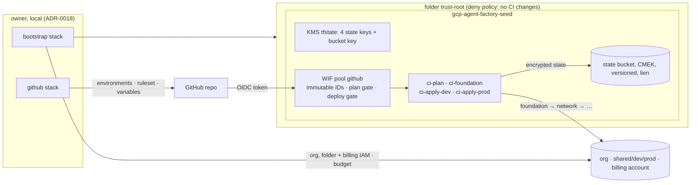

# 002: Bootstrap and CI pipeline (design)

## Overview

Two trust-root stacks, both applied locally by the owner ([ADR-0018](../../docs/adr/0018-trust-root-stacks-applied-locally.md)):

- **`bootstrap`** owns the org root:
  - the top-level folders `trust-root`, `shared`, `dev` and `prod`
  - all org-level and top-level-folder IAM
  - the seed project in `trust-root`, holding KMS keys, the state bucket, the WIF pool and the CI service accounts
  - a deny policy that keeps CI identities out of `trust-root`
  - the billing-account budget
- **`github`** writes the deployment rules into the repo: environments, reviewers, the `main` ruleset and CI variables.

A small Python tool turns a diff into a plan/apply matrix. Two workflows use it: `tofu.yml` plans each PR and applies after merge, and `drift.yml` runs nightly. A €0 `ci-canary` stack exercises the apply path in dev and prod before any real stack depends on it.



## Components and changes

| Component | Change |
|---|---|
| `platforms/stacks.yaml` | stack catalog: path, scope, environments, order, and plan/apply mode (`ci` or `local`) |
| `libs/stacks` | Python CLI. It maps changed files to affected stacks (following the module graph, and treating pipeline and toolchain files as "all") and emits the CI matrix. Unit and in-process BDD tests at 100% |
| `libs/repo-checks` | new checks: `encryption` (every root module has an enforced `encryption` block, [ADR-0011](../../docs/adr/0011-opentofu-with-state-encryption.md)) and `tofu-safety` (REQ-LZ-012) |
| `modules/project`, `modules/kms`, `modules/wif-github` | reusable modules with `tofu test`; `modules/project` is reused by 003 |
| `platforms/landing-zone/infra/bootstrap` | folders, seed project and lien, KMS, the state bucket, CI service accounts, WIF, org/folder/seed/billing IAM, the deny policy and the billing-account budget |
| `platforms/landing-zone/infra/github` | environments `foundation`/`dev`/`prod`, the `main` ruleset (imported), Actions variables |
| `platforms/landing-zone/infra/ci-canary` | `terraform_data` and outputs only, in `dev` and `prod`; it exists so the apply path is exercised from day one |
| `.github/workflows/tofu.yml`, `drift.yml` | plan on PR, apply on merge; nightly drift and read-only security checks |
| `.github/actions/setup-toolchain`, `gcp-auth`, `tofu-stack` | composite steps shared by both workflows |
| `platforms/landing-zone/tests/features/` | the scenarios of this spec. In-process ones move next to their code (`libs/stacks`, `libs/repo-checks`) as each is implemented; the deployed ones get their steps in `libs/testing` |
| `docs/runbooks/bootstrap.md` | prerequisites, first run, state migration, changing a trust-root stack, stale plans and stuck locks, restoring a state version |
| `mise.toml`, `.gitignore` | add `gcloud`; ignore `gha-creds-*.json` |

## Folders and identities

`bootstrap` creates the four top-level folders and the seed project. `ci-foundation`'s folder and project roles are granted on `shared`, `dev` and `prod` only, so nothing it holds is inherited by `trust-root`. Spec 003 manages what sits inside those three folders.

Each CI identity holds exactly these roles. The `bootstrap` tests pin them as an allow-list (REQ-LZ-010):

| Identity | Org | `shared`, `dev`, `prod` | Seed | Billing account | State keys |
|---|---|---|---|---|---|
| `ci-plan` | Browser, Security Reviewer, Deny Reviewer, Organization Policy Viewer, Folder Viewer, Tag Viewer | (inherited viewers) | Service Usage Consumer; viewers for KMS, WIF pools, service accounts, Service Usage, bucket metadata | Billing Account Viewer | encrypt/decrypt on all four (plans are encrypted too) |
| `ci-foundation` | Organization Policy Administrator, Tag Admin, Essential Contacts Admin | Folder Admin, Project Creator, Billing Project Manager, Tag User | Service Usage Consumer | Billing Account User, Billing Account Costs Manager | `shared` encrypt/decrypt; `trust-root` decrypt |
| `ci-apply-dev` | none | none (003 grants project roles in `gcp-agent-factory-dev`) | Service Usage Consumer | none | `dev` encrypt/decrypt; `shared`, `trust-root` decrypt |
| `ci-apply-prod` | none | none (003 grants project roles in `gcp-agent-factory-prod`) | Service Usage Consumer | none | `prod` encrypt/decrypt; `shared`, `trust-root` decrypt |

API quota is charged to the seed (`billing_project` + `user_project_override`).

Org Policy Administrator, Tag Admin and Essential Contacts Admin can only be granted at org level, or are only useful there, so they reach the seed by inheritance. The worst they allow there is denial of service or redirected notices, not access. Drift detection and the deny policy limit them. Tag Admin can't bind a tag to the seed, because that also needs a role on the seed. Spec 003 will keep tag-conditional IAM grants off the org level for the same reason.

**The deny policy on `trust-root`** names the four CI service accounts. It denies the permissions that would change:

- IAM on the folder, the seed project, its service accounts, keys and bucket
- service-account tokens and keys
- the WIF pool and providers
- KMS key versions
- the bucket
- the seed project's lien, existence, location or billing

The exact permission list is checked against what deny policies support during implementation.

**Org-level IAM** follows one rule: each role is managed in exactly one mode.

- **Authoritative** (one binding per role, listing every member, groups included): every role a CI identity holds, plus Project Creator (`gcp-org-admins` only) and Billing Account Creator (nobody). Folder IAM on `trust-root`, `shared`, `dev` and `prod` and the seed's admin roles (Owner, Editor, Storage Admin, Cloud KMS Admin, Workload Identity Pool Admin and Service Account Admin, all held by `gcp-org-admins`; no human or group gets Service Account Token Creator, which every CI identity would inherit) work the same way.
- **Additive**: only for roles no CI identity holds. These are Organization Administrator and Folder Creator for `gcp-org-admins`, and Billing Account Administrator, which stays additive so the personal owner can't be locked out.

Before the first apply, the authoritative list is compared with the org inventory (ADR-0017), so no existing holder disappears by surprise.

**WIF.** The expressions live in [`modules/wif-github/gates.json.tftpl`](../../modules/wif-github/gates.json.tftpl). Two mapped attributes gate the bindings:

```text
attribute.plan   = ((assertion.actor_id == '4373495' && assertion.event_name in ['pull_request', 'workflow_dispatch'])
                    || (assertion.ref == 'refs/heads/main' && assertion.event_name in ['push', 'schedule', 'workflow_dispatch']))
                   ? 'allowed' : 'denied'
attribute.deploy = (assertion.event_name == 'push'
                    && assertion.ref == 'refs/heads/main'
                    && assertion.job_workflow_ref == 'liljestk/gcp-agent-factory/.github/workflows/tofu.yml@refs/heads/main'
                    && assertion.workflow_ref == assertion.job_workflow_ref
                    && assertion.runner_environment == 'github-hosted'
                    && 'environment' in assertion)
                   ? assertion.environment : 'none'
```

The provider condition pins `repository_id` and `repository_owner_id`, and also requires `attribute.plan == 'allowed' || attribute.deploy != 'none'`. A token that passes neither gate is refused at the exchange, before any binding is consulted.

- `ci-plan` is bound to `attribute.plan/allowed`.
- Each apply identity is bound to `attribute.deploy/<environment>`.
- `none` can't be used as an environment name.

So these never reach an apply identity:

- a branch
- another workflow file, or a workflow that calls `tofu.yml`
- any event other than a push to `main` (`pull_request_target`, `issue_comment`, `workflow_run`, dispatches, schedules)
- a self-hosted runner
- a job without an environment

A bot's PR reaches `ci-plan` only when the owner triggers an event on it, for example a dispatch, a push, *Update branch* or a reopen. No claim names the PR author. `tests/iac/test_wif_gates.py` evaluates the same template against token claims for each of these cases.

Missing claims fail closed. The deploy gate is a chain of ANDs with `environment` guarded by `in`, so an error can't produce an environment. The plan gate's two clauses only lose an error to a clause that is itself a legitimate allow. A missing claim in the condition rejects the token.

## State layout

One bucket, `gcp-agent-factory-tfstate-<sfx>`, in `europe-north1`:

- uniform bucket-level access, public access prevention and standard labels
- versioning, with noncurrent versions deleted once 10 newer ones exist or after 30 days (two lifecycle rules)
- 7-day soft delete
- default CMEK key `tfstate/bucket`
- `prevent_destroy`, with `force_destroy` off
- a lien on the seed project

| Prefix | State key | Written by | Read by |
|---|---|---|---|
| `trust-root/bootstrap/` | `state-trust-root` | owner | `ci-plan`, `ci-foundation`, `ci-apply-*` |
| `trust-root/github/` | `state-trust-root` | owner | owner |
| `shared/<stack>/` | `state-shared` | `ci-foundation` | `ci-plan`, `ci-apply-*` |
| `dev/<stack>/` | `state-dev` | `ci-apply-dev` | `ci-plan` |
| `prod/<stack>/` | `state-prod` | `ci-apply-prod` | `ci-plan` |

- **Prefix access**: reads, writes and deletes (deletes are needed for locks) use IAM conditions on `resource.name` prefixes, written as allow-lists. Listing object names is granted bucket-wide, because a list call can't be prefix-conditioned, and names reveal nothing secret.
- **Encryption**: every root module uses `aes_gcm` with a `gcp_kms` key provider on its scope's key, enforced for state and plans. Remote-state data sources name the key of the state they read.
- **Variables**: bucket and key IDs are early-evaluated variables (OpenTofu ≥ 1.8). CI fills them from GitHub variables; the owner fills them from `bootstrap`'s outputs.
- **Key rotation**: keys rotate every 90 days. Old versions stay enabled so older state versions still decrypt.
- **No secrets in state**: no secret value ever enters state. Secret Manager versions are written outside OpenTofu (REQ-LZ-012).

## Pipeline

- **Catalog and matrix**: `stacks matrix --base <sha>` runs `git diff --name-only --no-renames -z <sha>...HEAD` itself and fails if git does (or `stacks matrix --all` for drift). It expands module changes to every stack that sources them (transitively). Changes to `mise.toml`, `stacks.yaml`, `.github/workflows/`, `.github/actions/`, `libs/stacks/`, `pyproject.toml`, `uv.lock` and `justfile` count as "all stacks". A stack's declared `inputs` (files it reads from outside its directory) count for that stack. Anything the tool can't follow (a non-literal module source, a symlink, an unparsable file, a module inside another stack) fails the run instead of planning less. It emits JSON by order tier. `bootstrap` is plan-only; `github` never appears.
- **On a pull request**:
  1. The plan job:
     - runs `just repo-checks` (including `tofu-safety`) before it authenticates
     - plans as `ci-plan` with `-lock=false`
     - uploads only the redacted `tofu show` text
     - permissions: `contents: read`, `id-token: write`
  2. The comment job:
     - runs no PR code and holds no Google credentials (`pull-requests: write`)
     - updates one comment per stack and environment, found by author `github-actions[bot]` and the marker `<!-- tofu-plan:<stack>/<env> -->`
  3. The aggregate `tofu-plan` job needs every plan job. It fails if any failed and passes when none ran. It is a required check.
- **On push to `main`**:
  1. **Bootstrap gate**: a gate job plans `bootstrap` with `-detailed-exitcode`. Exit code 2 fails with "apply bootstrap first", which stops every tier.
  2. **Tiers**: each order tier is a fixed job (`canary` → `foundation` → `network` → `ops` → …), with `if: ${{ !cancelled() && !failure() && <affected> }}`. Inside a tier, the prod job needs the dev job.
  3. **Plan**: as `ci-plan`, with `-lock=false`. It uploads the encrypted plan by exact path, as `plan-<stack>-<env>-<run_id>`, kept for 7 days. It writes the redacted plan and the plan file's SHA-256 to the job summary.
  4. **Apply**: in the stack's environment, as its apply identity. It downloads the artifact from the same run, checks the hash and applies. OpenTofu refuses a stale plan.
  5. **Concurrency**: plan and apply for one stack and environment share the group `tofu-<stack>-<env>` and are never cancelled in progress. GitHub keeps only the newest pending run, so the newest `main` wins. Its plan, if made before the previous apply finished, is refused as stale, and the next run plans again.
- **Drift** (nightly, plus manual dispatch):
  1. Every CI-applied stack and environment, plus `bootstrap`, runs `tofu plan -detailed-exitcode -lock=false` as `ci-plan`.
  2. Exit code 2 opens the issue `Drift: <stack>/<env>` (label `drift`) and comments whenever the drifted addresses change. Exit code 0 closes it. Exit code 1 opens `Drift check failed: <stack>/<env>`.
  3. The same workflow runs the read-only `@security` scenarios and the REQ-LZ-008 settings check, using the default `GITHUB_TOKEN`. Each failure becomes an issue.
- **Workflow hygiene** ([ADR-0012](../../docs/adr/0012-github-actions-wif-promote-by-digest.md)):
  - `permissions: {}` at the top
  - `id-token: write` only on jobs that authenticate
  - `persist-credentials: false`
  - no `pull_request_target`, `workflow_run` or `issue_comment` in any workflow that authenticates (zizmor `dangerous-triggers`)
  - every action pinned by SHA
  - credential files are never uploaded, and the workspace is never uploaded whole

## Where each scenario runs

| Scenarios | When | As |
|---|---|---|
| `identity`, `state`, `bootstrap` read-only `@security` checks: IAM policies, deny policy, bucket settings, the provider condition evaluated against recorded claim fixtures | nightly in `drift.yml`, and after each `bootstrap` apply | `ci-plan` |
| `pipeline` and `safety` in-process scenarios: matrix, workflow files, triggers, repo checks | every PR, in `just check` | none |
| `pipeline` `@acceptance` scenarios: canary apply with approval, the drift issue lifecycle | when spec 002 closes, and after each change to the pipeline | GitHub Actions |
| An STS exchange from another repository is refused | manual runbook step, from a scratch repository | owner |

## First run (owner, local)

1. **Prerequisites**: complete PLAN §12 (org and billing inventory, groups, phishing-resistant 2-step verification, the billing grant, the notification address). Rehearse the encryption sequence locally first: two `pbkdf2` methods, a local backend, no cloud.
2. **Roles for the run**:
   - Organization Administrator and Folder Creator via `gcp-org-admins`. Grant Folder Creator once with `gcloud`; `bootstrap` then imports and manages the binding.
   - Project Creator from the domain-wide grant, which `bootstrap` replaces with `gcp-org-admins`.
   - Billing Account User through `gcp-billing-admins`.
3. **Isolated credentials**: a temporary `CLOUDSDK_CONFIG`, then `gcloud auth application-default login` as the org identity. No coding agent runs during trust-root work.
4. **Inputs**: `bootstrap/terraform.tfvars` holds the org ID, customer ID and billing account ID. They are committed: they identify but don't authorize. Later stacks read them from `bootstrap`'s outputs.
5. **First apply**, with local state. The keys don't exist yet, so a documented `TF_ENCRYPTION` override encrypts the local state with a `pbkdf2` passphrase from an environment variable. The committed configuration always carries the enforced `gcp_kms` block.
6. **Migrate**: `tofu init -migrate-state` to the GCS backend under the `trust-root` key, with the passphrase method as `fallback` for that single run. Then drop the override, check that `tofu plan` is empty, and delete the local state files.
7. **Apply `github`** with a fine-grained token for this repository that expires the same day, importing ruleset `25774561`. Nothing else merges before this.
8. **Clean up**: revoke ADC and delete the temporary gcloud configuration.
9. **Prove the pipeline**:
   - A PR that touches `bootstrap` gets an empty CI plan.
   - Merging a `ci-canary` change applies dev, and prod waits for approval.

## Trust-root changes later specs need first

Each of these lands as a `bootstrap` PR that the owner applies before the spec's CI stack. The bootstrap gate enforces the order.

| Spec | Seed APIs to add | Roles to add |
|---|---|---|
| 002 (this spec) | `cloudresourcemanager`, `iam`, `iamcredentials`, `sts`, `cloudkms`, `storage`, `serviceusage`, `cloudbilling`, `billingbudgets`, `orgpolicy`, `essentialcontacts` | as in the table above |
| 003 | none expected | an inventory identity with Cloud Asset Viewer for ADR-0017's nightly checks (kept off `ci-plan`); `ci-plan` viewers for anything new |
| 004 | `compute`, `dns`, `accesscontextmanager` | Access Context Manager admin for the identity that manages VPC-SC (a scoped policy if possible); `ci-plan` network, DNS and Access Context Manager viewers |
| 005 | `pubsub`, `run`, `artifactregistry` | an image-build identity and an Artifact Registry location, decided in 005; `ci-plan` viewers |

## Well-Architected notes

- **Operational excellence**: one catalog drives PR plans, applies and drift. Trust-root changes still go through PR review and a CI plan, and the bootstrap gate keeps them in order. The runbook covers every manual step, including stale plans, stuck locks and restoring a state version.
- **Security**:
  - Keyless CI pinned to immutable IDs, the owner, `main` and one workflow file.
  - A trust-root folder with no CI roles, backed by a deny policy.
  - Per-scope state keys plus prefix IAM, and no secrets in state.
  - Org IAM in one mode per role.
- **Reliability**:
  - Saved plans with hash checks, and refusal of stale plans.
  - Per-stack concurrency, dev before prod.
  - Versioned state, soft delete, `prevent_destroy`, a lien, and an issue whenever a drift check itself fails.
- **Cost**: about €0.30/month idle, plus a gross-cost billing-account budget from the first apply.
- **Performance**: only affected stacks run.
- **Sustainability**: everything stays in `europe-north1`; the nightly drift run is the only scheduled work.

## Cost impact

| Item | Idle / month | Per use | Free tier | Guardrail |
|---|---|---|---|---|
| KMS, 5 software keys (4 state + bucket), 90-day rotation | ~€0.30 (~€0.06 per active version; the first rotation lands after the trial) | ~€0.03 per 10k operations, a few dozen per run | none | software keys only, no HSM |
| GCS state bucket, `europe-north1` | < €0.01 (a few MB) | operations ~€0 | Always Free covers US regions only | lifecycle: 10 noncurrent versions, 30 days |
| Billing-account budget, WIF, STS, IAM, Resource Manager, Service Usage, Admin Activity audit logs | €0 | €0 | free | no Data Access logs |
| GitHub Actions, including 7-day plan artifacts | €0 | €0 | free for public repos | concurrency groups; affected stacks only |

Net: about +€0.30/month idle and ~€0 per run (approx.). Budget: the €85 gross-cost billing-account budget from this spec's first apply. Spec 003 adds the seed (€4) and other project budgets. Avoid-list hits: none.

## Security impact

- **New identities**:
  - Four CI service accounts, and one WIF pool and provider with plan and deploy gates.
  - `ci-foundation` is the most powerful: org policy, tags, contacts, and folder, project and billing-link administration in `shared`, `dev` and `prod`. It is reachable only from the reviewed `tofu.yml` on `main` in the `foundation` environment, after the owner approves.
- **Org IAM changes**:
  - The domain-wide Project Creator and Billing Account Creator grants are removed.
  - Org, top-level-folder and seed IAM are managed by `bootstrap`, one mode per role.
  - A deny policy keeps CI out of `trust-root`.
- **Data flows**:
  - PR plan comments and job logs are public. Values that must not be shown are marked `sensitive`; IDs and the primary domain aren't secret (ADR-0017).
  - Saved plans are uploaded only in encrypted form.
- **No egress or secrets**: no new egress from GCP. CI holds no secrets beyond `GITHUB_TOKEN`.
- **Threats and mitigations**:
  - **PR code exfiltrating through a plan** (including PRs written by a coding agent, which run as the owner): `tofu-safety`, the plan gate, no secrets in state, and no data-reading roles for `ci-plan`.
  - **Approval or branch bypass**: deploy gate on `main` + `tofu.yml` + environment, with environment rules that admins can't bypass.
  - **Fork PRs**: no OIDC token.
  - **Leaked plan artifact**: ciphertext.
  - **State theft**: client-side encryption, CMEK and prefix IAM.
  - **`ci-foundation` turning on the trust root**: no inherited roles, plus the deny policy.
  - **The owner's workstation**: isolated, short-lived credentials (ADR-0018).

## Alternatives considered

- **Apply `bootstrap` from CI**: rejected in ADR-0018, because it needs a standing org-admin and billing-admin credential.
- **Seed in `shared`, protected by a deny policy alone**: one wrong deny rule would reopen the takeover path. An empty-of-CI folder fails safe.
- **One state key with prefix IAM only**: per-scope keys cost cents, and they stop one wrong bucket grant from exposing another scope's state.
- **One CI service account for everything**: simpler, but any job could change any environment.
- **Re-plan at apply time instead of saved plans**: the approver would approve something other than what gets applied.
- **Atlantis, Spacelift or Terraform Cloud**: an always-on server or an external SaaS. Neither fits OpenTofu + GitHub Actions + €0 idle.

## Risks and open questions

- **Domain restriction already enforced**: if the org already enforces Google's default `iam.allowedPolicyMemberDomains` (orgs created since May 2024 do), the WIF principal sets or the GCS service agent may be refused. The inventory reveals this. If so, `bootstrap` sets the managed `iam.managed.allowedPolicyMembers`, and spec 003 takes it over with `removed` and `import` blocks, so the constraint never has two owners.
- **Things to verify during implementation**:
  - that OpenTofu's `gcp_kms` key provider can read state with decrypt-only access. If it also calls Encrypt when it reads, the decrypt-only rows above become encrypt/decrypt on the other scopes' keys, and the matching `state.feature` rows change
  - which permissions deny policies support
  - whether the default `GITHUB_TOKEN` can read environment protection rules and rulesets
  - the first-run encryption sequence
- **Single-region state**: the bucket and keys live in `europe-north1` only, and a key's location can't change. A regional outage would block deploys, not running services. This is accepted for the trial; the Phase 7 DR drill revisits it (a dual-region bucket with a matching key location).
- **Teardown**: KMS keys can't be deleted, only their versions destroyed. End-of-trial teardown removes the lien, destroys the key versions and leaves the empty key ring.
